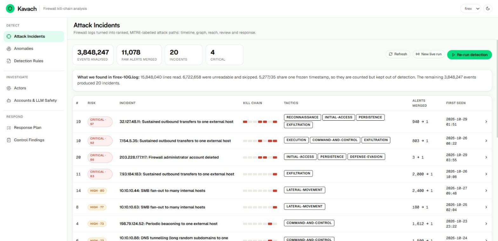
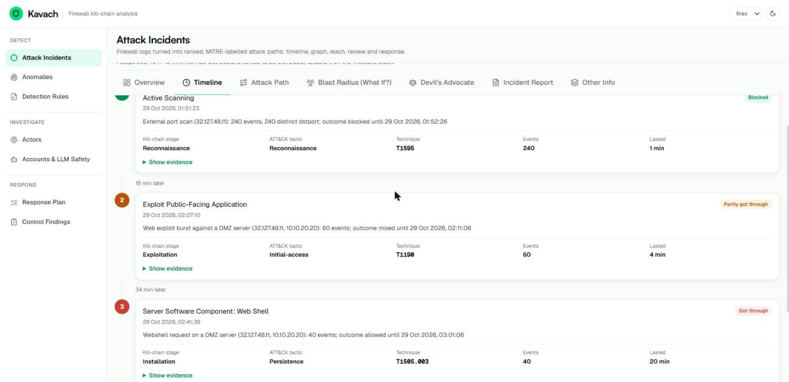
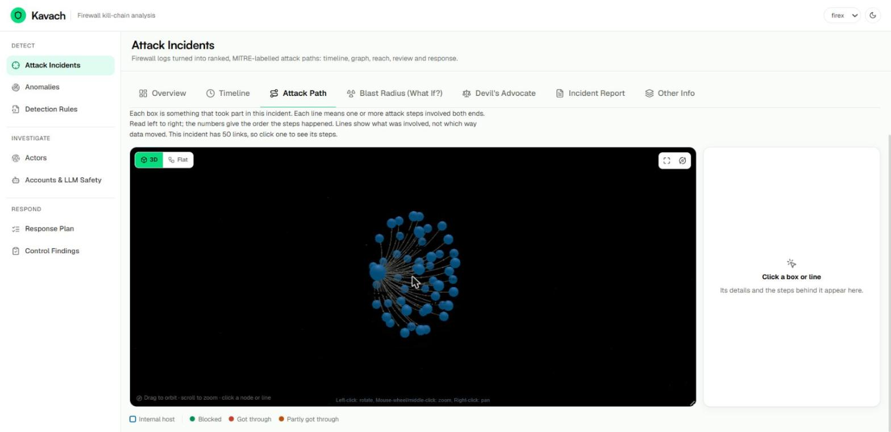
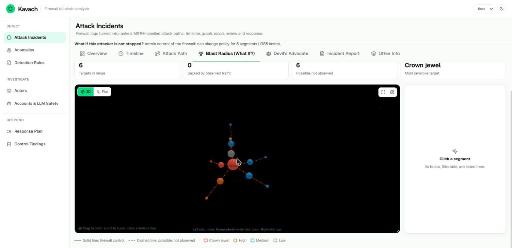
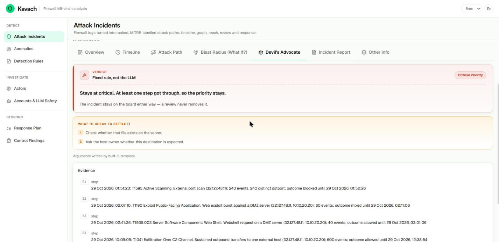
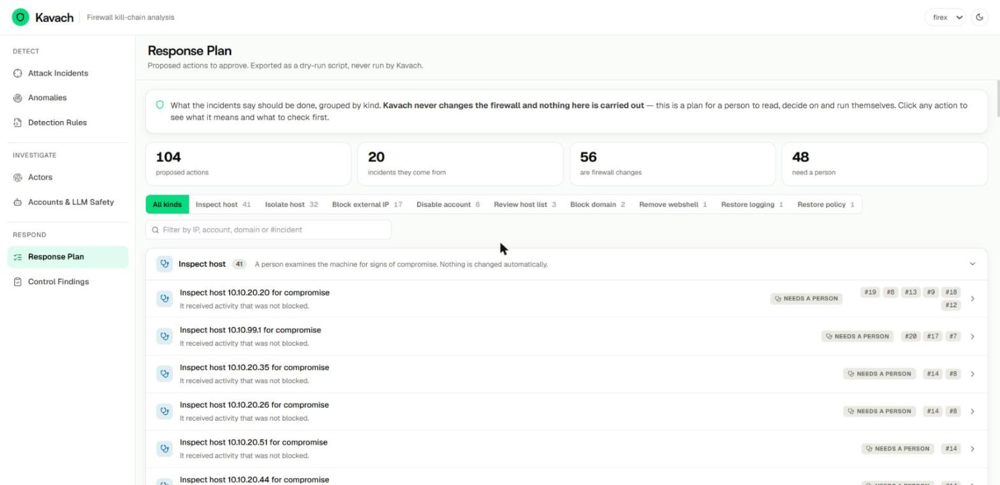
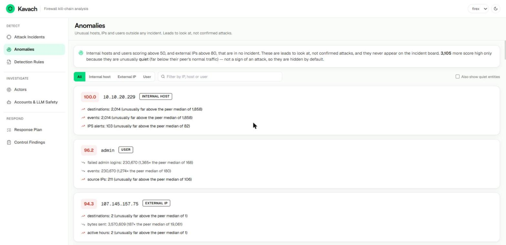
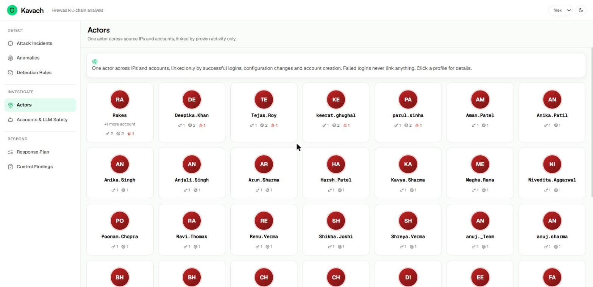
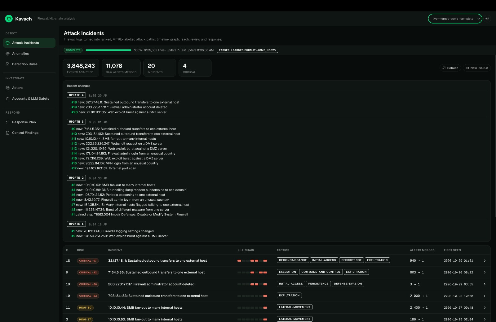
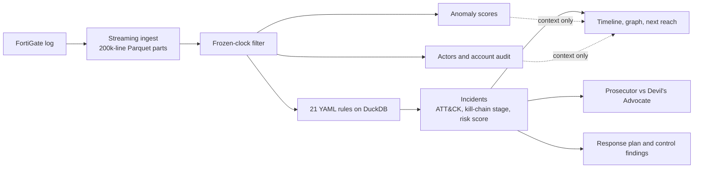

# Kavach
### Firewall kill-chain and attack path analysis

Kavach reads a raw FortiGate firewall log, finds the attacks hidden in it, labels every step with a
**MITRE ATT&CK technique and kill-chain stage**, links the steps into **incidents across hosts, users,
IPs and time**, and shows each one as a **timeline, an attack-path graph, what the attacker can reach
next, a Prosecutor vs Devil's Advocate review, and a response plan**.

Kavach is built and measured on FortiGate `key=value` logs. Other key=value, JSON or CSV logs go through an experimental
second parser, chosen automatically; see [Other log formats](#other-log-formats-experimental).

**▶ [Watch the demo video](https://drive.google.com/file/d/1GfeoTYjAO9I07pSrY4oQCMZ1rlvyFGef/view?usp=drive_link)**

## Results on `firex-10G.log`

| What we measure | Result | PRD Good / Great | |
|---|---|---|---|
| Detection (planted steps found) | **100%** (28/28) | > 70% / > 90% | 🟢 Great |
| Correct ATT&CK labels | **100%** (28/28) | > 60% / > 85% | 🟢 Great |
| Attack paths rebuilt in order | **20 / 20** (4 / 4 multi-step chains) | half / all | 🟢 Great |
| False alarms | **0%** (0 of 20 incidents) | < 30% / < 10% | 🟢 Great |
| Processing time (whole file) | **1.1 min** | < 3 h / < 1 h | 🟢 Great |
| Peak memory | **3.10 GB** | < 16 GB / < 8 GB | 🟢 Great |
| Open one incident | **0.02 ms** in-process lookup; about 0.2 s measured once over HTTP | < 2 s / < 500 ms | 🟢 Great |

11,078 raw alerts were merged into 20 incidents. These results depend on a ground truth we built
ourselves; see [Honest limits](#honest-limits). Full scorecard:
[`reports/killchain_benchmark.md`](reports/killchain_benchmark.md).

### What is in the log

| Lines | Count | What happens to them |
|---|---:|---|
| Read | 15,848,040 | |
| Unreadable (about 1.7 GB of random bytes at the end) | 6,722,658 | Skipped and counted |
| Parsed, under one frozen timestamp | 5,277,135 | Counted, kept out of detection, baselines and the reach graph |
| Analysed | 3,848,247 | |

### Results on every log we ran

All runs used 6 workers and a 7 GB database cap, on one laptop: 14 cores, 15.5 GB RAM, SSD.

| Log | Type | File size | Lines read | Frozen clock | Unreadable | Analysed | Time | Peak RAM | Incidents |
|---|---|---:|---:|---:|---:|---:|---:|---:|---:|
| `firex-10G.log` | Supplied | 6.5 GB | 15.8M | 5.3M | 6.7M | 3.85M | **1.1 min** | **3.1 GB** | 20 |
| `firex-50G.log` | Supplied | 32.7 GB | 62.0M | 43.7M | 0 | 18.3M | **7.3 min** | **4.8 GB** | 20 |
| Synthetic log | Made by us | 30 GB | 56.8M | 0 | 0 | 56.8M | **13.3–19.3 min** | **7.2 GB** | 65 |

- **Why the synthetic log takes longest:** every line is analysed. It repeats real traffic from `firex-50G.log` with
  shifted times and changed IPs and usernames, so it measures speed and memory, not accuracy. The time range is two runs of
  the same file; the slower one ran while other work was using the laptop.
- **`firex-50G.log` is 32.7 GB despite its name,** and 70% of its lines sit under one frozen timestamp. They are read but
  not analysed, which is why it finishes before the smaller synthetic file.
- **Where the time goes on `firex-50G.log`:** reading 307 s, detection 72 s, anomaly scoring 56 s, the rest 5 s.
- **One core vs six workers on `firex-10G.log`:** 4.5 min and 1.76 GB became 1.1 min and 3.1 GB. All 9,125,382 parsed rows
  matched between the two.

### Accuracy on `firex-50G.log`

No official answer key was supplied for either log, so **these accuracy numbers come from benchmarks we built, not one given
to us**. We analysed the logs and chose the `crscore` tag, which we assumed marks planted attacks, and hunted for the attacks
it doesn't cover. For `firex-50G.log`, a separate LLM analysed the file blind to our rules and wrote a second answer key.

| Benchmark | Detection | Correct labels | Paths rebuilt | False alarms by that key |
|---|---:|---:|---:|---:|
| `crscore` lines only | 550 of 550 lines | not measured | not measured | not measured |
| Blind answer key | **95.8%** (23 of 24) | 91.3% | 16 of 18 | 10.5% (2 of 19) |
| Blind answer key, after adding `KC-ID-005` | 100% (24 of 24) | 91.7% | 17 of 18 | 10.0% (2 of 20) |

**The blind result is 95.8%.** The 100% came after we added a rule for the one missed step, so it isn't blind. The rules were
written on a different file, but the attacks look like they came from the same generator. The 2 "false alarms" are a
periodic connection and an SMB and RDP spread that the blind key doesn't mention; our review suggests they are real attacks,
but that review is ours.

### Second parser results

The second parser reads formats other than FortiGate. We tested it by rewriting `firex-10G.log` with other field and value
names, which gives a known correct answer, and by forcing `firex-50G.log` through it.

| Test | Fields right | Values right | Incidents matching the normal parser |
|---|---:|---:|---:|
| `firex-50G.log`, unchanged names | 40 of 40 | not scored | **20 of 20** (8.3 min, plus 7.6 min to learn the format once) |
| Rewritten, vendor-style names | 40 of 40 | 27 of 27 | **20 of 20** |
| Rewritten, readable names, before the login fix | 40 of 40 | 26 of 26 | 18 of 20 |
| Rewritten, obscure names, before the login fix | 37–40 of 40 | 17–23 of 26 | 10–12 of 20 |

We wrote these test names ourselves, and no real log from a second vendor has been tested. The vendor-style 20 of 20 is one
run. `firex-10G.log` itself has not finished through the second parser: readable scraps in its junk tail look like about 236
extra fields, and that run hit the Groq daily token limit.

## Screenshots

### Attack incidents
Every incident ranked by risk, with its kill-chain stages, tactics and how many raw alerts it merged.



### Timeline
Each step of an attack in order, with its ATT&CK technique, outcome and evidence.



### Attack path
Everything that took part in an incident and how it connects. This is an SMB spread from one host to 50 others.



### Blast radius (What if?)
What the attacker could reach next. Here, firewall admin control reaches 6 network segments. Reach is marked as observed in
the log, or possible but not observed.



### Devil's Advocate
Both sides argue from numbered evidence. The verdict comes from a fixed rule, not the LLM.



### Response plan
Proposed actions grouped by kind, each explained. Kavach never changes the firewall.



### Anomalies
Unusual entities outside any incident, each with the reason it stands out. These are leads, not confirmed attacks.



### Actors
One actor across IPs and accounts, linked only by proven activity.



### Live mode
Incidents appear while the file is still being read, with a change feed of what each update added. This run used another
vendor's format, so the parser badge says "learned format".



## How to run Kavach, step by step

These steps work on a new laptop, from nothing to the running site. We followed them on a fresh clone on Windows using a
sample of the log. Commands are shown for **Windows (PowerShell)** and **macOS / Linux**; use one set.

### What you need

| Need | Details |
|---|---|
| **Python** | 3.10 or newer. Check with `python --version` |
| **Node.js** | 18 or newer. Check with `node --version` |
| **Git** | Check with `git --version` |
| **RAM** | 8 GB for `firex-10G.log`. **16 GB** recommended for larger logs |
| **Free disk** | About 3 GB, plus the log itself. More for larger logs |
| **The log file** | `firex-10G.log` or `firex-50G.log`. These are **not in this repo**; they come from the hackathon organisers |

A Groq API key is optional. FortiGate logs and every page work without one.

### Step 1: Get the code

**First time:**

```bash
git clone https://github.com/Jival-Raghav/PROJECT_KAVACH.git
cd PROJECT_KAVACH
git switch main
```

**Already have it:**

```bash
cd PROJECT_KAVACH
git switch main
git pull origin main
```

### Step 2: Create a Python environment

**Windows (PowerShell)**

```powershell
python -m venv .venv
.\.venv\Scripts\Activate.ps1
```

**macOS / Linux**

```bash
python3 -m venv .venv
source .venv/bin/activate
```

Your prompt should now start with `(.venv)`.

### Step 3: Install the Python packages

```bash
pip install -r requirements.txt
```

### Step 4: Create your settings file

**Windows (PowerShell)**

```powershell
Copy-Item .env.example .env
```

**macOS / Linux**

```bash
cp .env.example .env
```

### Step 5: Tell Kavach where the log is

Open `.env` in a text editor and add this line, using the full path to your log. Use forward slashes, even on Windows:

```env
KILLCHAIN_LOG_PATH=C:/path/to/firex-10G.log
```

Or skip this step by putting the file at `REAL_10G_DATA/firex-10G.log` inside the project folder.

### Step 6: Analyse the log

```bash
cd backend
python -m killchain.cli run
cd ..
```

Kavach picks the parser by itself; you should see `FortiGate log: using the standard parser`. Reading `firex-10G.log` takes
about 1–2 minutes and ends by printing a summary with `"incident_count": 20`. This only needs doing once per log, because
results are saved.

### Step 7: Start the API (Terminal 1)

Run this from the project folder, with `(.venv)` active, and leave the terminal open:

```bash
python -m uvicorn backend.main:app --port 8000
```

### Step 8: Start the website (Terminal 2)

Open a **second terminal** in the project folder, then:

```bash
cd frontend
npm install
npm run dev
```

`npm install` is only needed the first time. Leave this terminal open too.

### Step 9: Open Kavach

Open **http://localhost:5173** in your browser. You should see the incident board. Click any incident for its timeline,
attack path, blast radius, Devil's Advocate review and report. API docs are at http://localhost:8000/docs.

**To stop:** press `Ctrl+C` in both terminals.

**To start again later:** activate the environment as in Step 2, then repeat Steps 7–9. You don't need Step 6 again.

### Optional: analyse another log

Give each log its own run name, then pick it from the selector in the top bar of the site:

```bash
cd backend
python -m killchain.cli run --log C:/path/to/firex-50G.log --run-id firex_50g
cd ..
```

Refresh the site if the new run isn't listed. To watch incidents appear as a file is read, press **New live run** on the
Attack Incidents page; see [Live mode](#live-mode-b-5).

### Optional: turn on the LLM

Needed only for **Run live review**, **Rewrite with AI**, and learning a log format Kavach hasn't seen. Add your key to `.env`,
then restart the API:

```env
GROQ_API_KEY=your_key
LLM_REPLAY_ONLY=0
```

These features send real log details to Groq. See [Honest limits](#honest-limits).

### If something goes wrong

| Problem | Fix |
|---|---|
| **`python` is not found** | On macOS or Linux use `python3`. On Windows, reinstall Python with "Add to PATH" ticked |
| **PowerShell says running scripts is disabled** | Run `Set-ExecutionPolicy -Scope Process RemoteSigned`, then repeat the activate command |
| **`ImportError: DLL load failed... Application Control policy has blocked this file`** | Windows Smart App Control is checking newly downloaded files. Run the same command again; this cleared it on our laptop |
| **`Log not found`** | Check the path in `.env` from Step 5, and use forward slashes |
| **`This is not a FortiGate log`, or a message about learning a new format** | The file isn't a FortiGate log. Check the path. To learn a new format, turn on the LLM |
| **`Could not recognise this log`** | Kavach reads only key=value, JSON and CSV logs |
| **The site shows no incidents** | Step 6 hasn't finished, or the API in Terminal 1 isn't running. Then press **Refresh** |
| **Port 8000 or 5173 is in use** | Close whatever is using it. The site expects exactly these two ports |
| **The run is very slow, or stops on low memory** | Close other apps, or lower the limits in `.env`: `KILLCHAIN_DUCKDB_MEMORY=4GB` and `KILLCHAIN_INGEST_WORKERS=2` |
| **Groq reports a rate limit** | You've hit your plan's token limit. Wait, or use a saved schema. FortiGate logs don't use the LLM |

**macOS / Linux shortcut:** `./run.sh --killchain` sets up everything, builds the incidents and starts the API and site. We
didn't test this script on the current code.

**Docker:** `docker compose up --build` (API on :8000, UI on :5173, log at `REAL_10G_DATA/`). The
Docker path has not been tested on the current code.

**Commands:**

```bash
cd backend
python -m killchain.cli run                # ingest, detect, correlate, score, enrich
python -m killchain.cli run --skip-ingest  # re-run everything after ingest
python -m killchain.cli bench              # score against the ground truth, write reports/
```

## Live mode (B-5)

Live mode streams a log file into Parquet parts and re-runs the full analysis after each new part, so
incidents appear while the file is still being read.

- **From the UI:** on Attack Incidents press **New live run**, enter the path of a file on the machine
  running the API, and start. A live bar shows progress, the update number and Stop / Resume. A change
  feed lists what each update added, merged or withdrew. The run selector in the top bar switches between
  runs; the batch run `firex` is never touched.
- **From the CLI:** `cd backend && python -m killchain.cli live --path FILE [--run-id ID] [--batch-size N]`
  (default batch 200,000 lines). Ctrl-C stops cleanly; the same `--run-id` resumes.
- **API:** `POST /api/live/start`, `GET /api/live/status`, `GET /api/live/changes`,
  `POST /api/live/stop`, `GET /api/runs`.
- **Inputs:** a raw, uncompressed log file. FortiGate logs use the standard parser; other key=value, JSON or CSV
  logs use a saved schema or learn one, as in [Other log formats](#other-log-formats-experimental), and the live bar
  shows which parser is in use. Not accepted: a `.zip` (rejected with "Zip archives are not supported") or a folder.
  A file with no readable line in its first 100,000 lines ends with an error. A raw file resumes from its byte
  checkpoint.
- **`.gz` files don't work yet:** the reader can stream them, but the automatic parser check reads the file without
  decompressing it, so it stops with an error. Decompress the file first.
- **CLI and UI together:** a run started with `cli live` shows as processing in the UI (the job records
  its process id and a heartbeat in `live_state.json`); it shows as interrupted only once that process
  is gone or its heartbeat is over 60 s old. A run being processed elsewhere cannot be started again,
  and batch runs cannot be reused for live mode.
- **What updates and when:** after each new part is analysed (an "update"), every view refreshes on its
  own within about 2 seconds: the incident list, an open incident's timeline, attack path, blast radius,
  review and report, plus anomalies, actors, accounts, response plan and control findings. The change
  feed lists what that update changed.
- **Stable numbers:** an incident keeps its number across updates (`incident_registry.json`). A merged
  incident redirects to its surviving number and a withdrawn one shows a notice; both are recorded in the
  change feed (`changes.jsonl`), nothing is renumbered.
- **Limits:** results under 25% of the file are early and can change. Every update re-analyses
  everything read so far, so updates slow down as the file grows. The run name `firex` is refused.

**Rehearsal on `firex-10G.log` (4.8 GB, one MacBook run):** first update after 21 s, finished in
217 s (3.6 min, `/usr/bin/time` wall clock) over 9 updates, peak memory 3.04 GB (`maximum resident set size`). The final 20
incidents have the same titles as the batch run. Updates took about 20 to 40 s each once the file was
more than a quarter read. This is one run, not a benchmark.

## Pipeline



## PRD requirements

| PRD | Feature | Where |
|---|---|---|
| FR-1 | Streams the log in 200k-line batches into Parquet; never loads the file | `backend/killchain/ingest.py` |
| FR-2 | 21 behavioural rules: bursts, fan-out, periodicity, rarity, sequences | `config/detection_rules/fortigate.yaml` |
| FR-3 | Every detection gets an ATT&CK technique, tactic and kill-chain stage | `config/mitre_techniques.yaml` |
| FR-4 | Links detections by attacker IP, user or domain, same host, and pivot host plus time | `backend/killchain/correlate.py` |
| FR-5 | Timeline and host/user/attacker graph | `GET /api/incidents/{id}/path` |
| FR-6 | What the attacker can reach next: observed flows, same segment, firewall admin control | `GET /api/incidents/{id}/next` |
| FR-7 | REST API, web UI and this README | `GET /api/incidents`, `/docs` |
| B-1 | Risk score: progression, breadth, success, severity, volume | `backend/killchain/scoring.py` |
| B-2 | Plain-English report with optional LLM rewrite | `GET /api/incidents/{id}/report?llm=true` |
| B-3 | Raw alerts merged per incident | `raw_alert_count` on every incident |
| B-4 | A new rule means editing YAML, not code | `config/detection_rules/` |
| B-5 | Live mode: streams a file and re-analyses after each part | `backend/killchain/live.py`, `POST /api/live/start` |

## Beyond the PRD

All of these are context. **None can create an incident or change a risk score.**

| Page | What it does | Where |
|---|---|---|
| Anomalies | Isolation Forest per entity type. Lists internal hosts and users above 50 and external IPs above 80 that are in no incident, each with a reason. These are leads, not confirmed attacks; most reflect noise in this log. | `backend/killchain/anomaly.py` |
| Actors | Links IPs and accounts using successful logins, configuration changes and account creation. Failed logins never link anything. | `backend/killchain/actors.py` |
| Accounts & LLM Safety | Audits accounts proven active in the log. Service and shared types are inferred from names. | `backend/killchain/accounts.py` |
| Incident review | Prosecutor and Devil's Advocate argue from numbered evidence. Uses a live LLM, then the saved answer, then a built-in template. | `backend/killchain/review.py` |
| Response Plan | Proposed actions per incident, grouped by kind, each explained. Read-only: **Kavach never changes the firewall** and the UI carries nothing out. The approval, audit and dry-run-script endpoints still exist in the API. | `backend/killchain/response.py` |
| Control Findings | Nine controls marked as gap, attempted or no failure seen. The standards mapping is ours and is not an audit. | `config/firewall_controls.yaml` |

The review verdict is computed by a fixed rule, so log text and LLM answers cannot change it. It lowers
priority only when every step was blocked and there is no foothold. On this log that lowers nothing, so
the Devil's Advocate's use here is naming the innocent explanation to rule out, not removing false alarms.

### Live LLM review (optional)

Without a key, reviews use the template. To go live, set these in `.env`:

```env
GROQ_API_KEY=your_key
LLM_REPLAY_ONLY=0
```

Press **Run live review** on an incident. Successful answers are saved and replayed if the LLM later
fails. This review path has been tested with simulated responses. Real Groq calls have been used for learning log
formats, but a full run of the live review against real Groq has not been measured.

## Other log formats (experimental)

Kavach chooses the parser for any input file. FortiGate logs use the normal parser, with no LLM. Other key=value, JSON or
CSV logs reuse a saved schema if the format is known. Otherwise common words match the obvious names, an LLM handles the
rest, code checks every answer against the data, and the schema is saved so the format is only learned once. Parsing
itself never calls an LLM. The log is translated into the same columns, so rules and analysis run unchanged.

Results from an automatically learned schema are marked as not reviewed until a person checks and approves it:

```bash
cd backend
python -m killchain.cli run --log LOG --run-id NAME   # learns the format if needed; sends statistics and sample records to the LLM
python -m killchain.cli approve-schema data/killchain/schemas/LOG.yaml
```

Tested by rewriting `firex-10G.log` with different names (`scripts/bench_schema_onboarding.py`), before a later fix for
login values: two readable name sets found all 20 attacks, with 40 of 40 fields and 26 of 26 values right, but 2 incidents
had the wrong outcome and risk. A set of deliberately obscure names found 14 of 20. **No real log from another vendor has
been tested**, and rule thresholds were tuned on FortiGate. Review every schema before trusting its results.

## Add a detection rule (B-4)

```yaml
# config/detection_rules/fortigate.yaml
  - id: KC-CUSTOM-001
    title: Outbound SSH from the DMZ
    technique: T1021.004          # must exist in config/mitre_techniques.yaml
    severity: high
    kind: threshold               # match | threshold | rare_for_entity | sequence
    where: "type='traffic' AND action='accept' AND srcintfrole='dmz' AND dstintfrole='wan'"
    selection: {dstport: 22}      # Sigma-style: field, field|contains, |startswith, |re, lists = IN
    group_by: [srcip]
    window_minutes: 30
    min_count: 5
    entities: {src_ip: srcip, dst_ip: dstip}
```

Then press **Re-run detection** in the UI, or run `python -m killchain.cli run --skip-ingest`.

## Honest limits

- **We built the ground truth ourselves.** The dataset came without labels, so we recovered
  [`data/ground_truth/firex_planted.yaml`](data/ground_truth/firex_planted.yaml) from rare events, the
  `crscore` field that some planted lines carry, and periodicity and repeated-pair analysis. Rules and
  ground truth were developed on the same log, so the 100% scores are not an independent test. A test
  checks that no rule contains any of its IPs, users or domains.
- **The ground truth was widened once during tuning.** The first run produced 4 detections outside it.
  They looked like planted activity without `crscore`, so 5 steps were added. The 0% false-alarm rate
  is measured against the widened set.
- **Detection is generous.** A step counts as found if a detection overlaps at least one of its lines.
- **Scale results are limited.** With 6 workers and a 7 GB database cap, on a 14-core laptop with an SSD:
  `firex-50G.log` (32.7 GB, 18.3M of 62M lines analysed) took 7.3 min and about 5 GB, and a 30 GB synthetic log with
  all 56.8M lines analysed took 13.3 min and 7.17 GB. The synthetic log repeats real traffic, so it measures speed and
  memory only. Nothing has been run on 50 GB of fully valid logs. Set `KILLCHAIN_DUCKDB_MEMORY` and
  `KILLCHAIN_INGEST_WORKERS` for other machines.
- **`firex-50G.log` was also scored against a separate answer key** from a blind analysis by another LLM, not official
  labels. Blind result: 95.8% detection (23 of 24 steps), 91.3% labels, 16 of 18 paths, 10.5% false alarms by that key.
  `KC-ID-005` was then added for the one missed step, so its later 100% detection is post-fix, not blind.
- **Timestamps:** every line says `+0530`, but `eventtime` matches the wall clock read as UTC. We display
  it as the firewall's local clock.
- **LLM privacy:** live reviews, report rewrites and log onboarding send real IPs, usernames and log details to the
  configured provider, without pseudonymization, and only when an analyst asks. Use a local provider or
  `LLM_REPLAY_ONLY=true` if this data must not leave your network.
- **Prompt injection:** log text is sanitized and scanned first. In [our test](reports/log_injection.md)
  all 32 payloads left the verdict unchanged, but the detector flagged only 12 of 32, and no real LLM was
  tested. An unflagged payload could still sway an LLM's written arguments.
- **No login.** Anyone who can reach the API can approve actions. This is built for local use.
- **Dry-run commands are untested on a device.** Review them before use.
- Rule files are trusted configuration, because their SQL runs as written. Protect
  `config/detection_rules/` like source code.

## Verify

```bash
pytest tests/ -q
ruff check .
python scripts/bench_log_injection.py
```

## Layout

```
backend/
  api/incidents.py     REST API
  killchain/           parser, rules, incidents, scoring, reach, review, response and more
  graph/blast.py       reachability search
  llm/                 LLM provider clients
  security/            sanitizer and prompt-injection detector
config/                detection rules, ATT&CK catalogue, assets, control catalogue
data/ground_truth/     ground truth we recovered for firex-10G.log
frontend/src/pages/    the seven pages and the incident view
reports/               benchmark results
scripts/               benchmarks
tests/                 test suite
```

## Team

- **Jival Raghav Balaji** ([@Jival-Raghav](https://github.com/Jival-Raghav))
- **Sumeet Tummaramatti** ([@sumeettummarmatti](https://github.com/sumeettummarmatti))

Third-party libraries are listed in [`THIRD_PARTY.md`](THIRD_PARTY.md).
