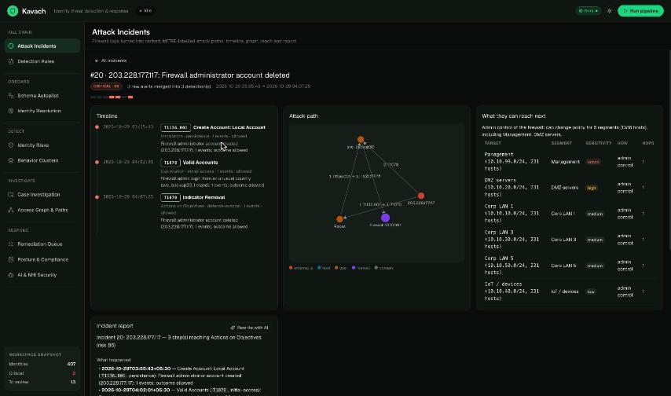
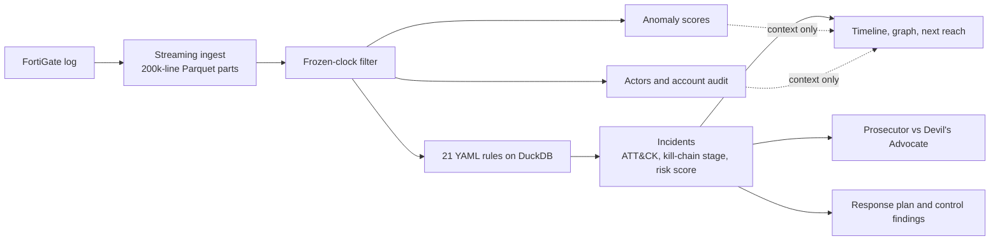

# Kavach
### Firewall kill-chain and attack path analysis

Kavach reads a raw FortiGate firewall log, finds the attacks hidden in it, labels every step with a
**MITRE ATT&CK technique and kill-chain stage**, links the steps into **incidents across hosts, users,
IPs and time**, and shows each one as a **timeline, an attack-path graph, what the attacker can reach
next, a Prosecutor vs Devil's Advocate review, and a response plan**.

Kavach accepts FortiGate `key=value` logs only.

## Results on `firex-10G.log`

| What we measure | Result | PRD Good / Great | |
|---|---|---|---|
| Detection (planted steps found) | **100%** (28/28) | > 70% / > 90% | 🟢 Great |
| Correct ATT&CK labels | **100%** (28/28) | > 60% / > 85% | 🟢 Great |
| Attack paths rebuilt in order | **20 / 20** (4 / 4 multi-step chains) | half / all | 🟢 Great |
| False alarms | **0%** (0 of 20 incidents) | < 30% / < 10% | 🟢 Great |
| Processing time (whole file) | **1.1 min** | < 3 h / < 1 h | 🟢 Great |
| Peak memory | **3.10 GB** | < 16 GB / < 8 GB | 🟢 Great |
| Open one incident | **0.02 ms** in-process lookup; about 0.2 s measured once over HTTP | < 2 s / < 500 ms | 🟢 Great |

11,078 raw alerts were merged into 20 incidents. These results depend on a ground truth we built
ourselves; see [Honest limits](#honest-limits). Full scorecard:
[`reports/killchain_benchmark.md`](reports/killchain_benchmark.md).

### What is in the log

| Lines | Count | What happens to them |
|---|---:|---|
| Read | 15,848,040 | |
| Unreadable (about 1.7 GB of random bytes at the end) | 6,722,658 | Skipped and counted |
| Parsed, under one frozen timestamp | 5,277,135 | Counted, kept out of detection, baselines and the reach graph |
| Analysed | 3,848,247 | |



## Quick start

Requires Python 3.10+ and Node.js 18+. The log can live at `REAL_10G_DATA/firex-10G.log`, or anywhere
if you set `KILLCHAIN_LOG_PATH` in `.env`.

**macOS / Linux**

```bash
./run.sh --killchain   # sets up everything, builds the incidents (about 2 min), starts API and UI
```

**Windows (PowerShell)**

```powershell
python -m venv .venv; .\.venv\Scripts\Activate.ps1
pip install -r requirements.txt
Copy-Item .env.example .env      # then set KILLCHAIN_LOG_PATH if the log is elsewhere
cd backend; python -m killchain.cli run; cd ..
uvicorn backend.main:app --port 8000      # in one terminal
cd frontend; npm install; npm run dev     # in another
```

Open http://localhost:5173. API docs are at http://localhost:8000/docs.

**Docker:** `docker compose up --build` (API on :8000, UI on :5173, log at `REAL_10G_DATA/`). The
Docker path has not been tested on the current code.

**Commands:**

```bash
cd backend
python -m killchain.cli run                # ingest, detect, correlate, score, enrich
python -m killchain.cli run --skip-ingest  # re-run everything after ingest
python -m killchain.cli bench              # score against the ground truth, write reports/
```

## Live mode (B-5)

Live mode streams a log file into Parquet parts and re-runs the full analysis after each new part, so
incidents appear while the file is still being read.

- **From the UI:** on Attack Incidents press **New live run**, enter the path of a file on the machine
  running the API, and start. A live bar shows progress, the update number and Stop / Resume. A change
  feed lists what each update added, merged or withdrew. The run selector in the top bar switches between
  runs; the batch run `firex` is never touched.
- **From the CLI:** `cd backend && python -m killchain.cli live --path FILE [--run-id ID] [--batch-size N]`
  (default batch 200,000 lines). Ctrl-C stops cleanly; the same `--run-id` resumes.
- **API:** `POST /api/live/start`, `GET /api/live/status`, `GET /api/live/changes`,
  `POST /api/live/stop`, `GET /api/runs`.
- **Inputs:** a raw FortiGate `key=value` log or a `.gz` of one. Not accepted: a `.zip` (rejected with
  "Zip archives are not supported") or a folder. A file with no FortiGate line in its first 100,000
  lines ends with an error. A raw file resumes from its byte
  checkpoint. A `.gz` is decompressed again from the start and lines already written are skipped.
- **CLI and UI together:** a run started with `cli live` shows as processing in the UI (the job records
  its process id and a heartbeat in `live_state.json`); it shows as interrupted only once that process
  is gone or its heartbeat is over 60 s old. A run being processed elsewhere cannot be started again,
  and batch runs cannot be reused for live mode.
- **What updates and when:** after each new part is analysed (an "update"), every view refreshes on its
  own within about 2 seconds: the incident list, an open incident's timeline, attack path, blast radius,
  review and report, plus anomalies, actors, accounts, response plan and control findings. The change
  feed lists what that update changed.
- **Stable numbers:** an incident keeps its number across updates (`incident_registry.json`). A merged
  incident redirects to its surviving number and a withdrawn one shows a notice; both are recorded in the
  change feed (`changes.jsonl`), nothing is renumbered.
- **Limits:** results under 25% of the file are early and can change. Every update re-analyses
  everything read so far, so updates slow down as the file grows. The run name `firex` is refused.

**Rehearsal on `firex-10G.log` (4.8 GB, one MacBook run):** first update after 21 s, finished in
217 s (3.6 min, `/usr/bin/time` wall clock) over 9 updates, peak memory 3.04 GB (`maximum resident set size`). The final 20
incidents have the same titles as the batch run. Updates took about 20 to 40 s each once the file was
more than a quarter read. This is one run, not a benchmark.

## Pipeline



## PRD requirements

| PRD | Feature | Where |
|---|---|---|
| FR-1 | Streams the log in 200k-line batches into Parquet; never loads the file | `backend/killchain/ingest.py` |
| FR-2 | 21 behavioural rules: bursts, fan-out, periodicity, rarity, sequences | `config/detection_rules/fortigate.yaml` |
| FR-3 | Every detection gets an ATT&CK technique, tactic and kill-chain stage | `config/mitre_techniques.yaml` |
| FR-4 | Links detections by attacker IP, user or domain, same host, and pivot host plus time | `backend/killchain/correlate.py` |
| FR-5 | Timeline and host/user/attacker graph | `GET /api/incidents/{id}/path` |
| FR-6 | What the attacker can reach next: observed flows, same segment, firewall admin control | `GET /api/incidents/{id}/next` |
| FR-7 | REST API, web UI and this README | `GET /api/incidents`, `/docs` |
| B-1 | Risk score: progression, breadth, success, severity, volume | `backend/killchain/scoring.py` |
| B-2 | Plain-English report with optional LLM rewrite | `GET /api/incidents/{id}/report?llm=true` |
| B-3 | Raw alerts merged per incident | `raw_alert_count` on every incident |
| B-4 | A new rule means editing YAML, not code | `config/detection_rules/` |
| B-5 | Live mode: streams a file and re-analyses after each part | `backend/killchain/live.py`, `POST /api/live/start` |

## Beyond the PRD

All of these are context. **None can create an incident or change a risk score.**

| Page | What it does | Where |
|---|---|---|
| Anomalies | Isolation Forest per entity type. Lists internal hosts and users above 50 and external IPs above 80 that are in no incident, each with a reason. These are leads, not confirmed attacks; most reflect noise in this log. | `backend/killchain/anomaly.py` |
| Actors | Links IPs and accounts using successful logins, configuration changes and account creation. Failed logins never link anything. | `backend/killchain/actors.py` |
| Accounts & LLM Safety | Audits accounts proven active in the log. Service and shared types are inferred from names. | `backend/killchain/accounts.py` |
| Incident review | Prosecutor and Devil's Advocate argue from numbered evidence. Uses a live LLM, then the saved answer, then a built-in template. | `backend/killchain/review.py` |
| Response Plan | Proposed actions per incident, grouped by kind, each explained. Read-only: **Kavach never changes the firewall** and the UI carries nothing out. The approval, audit and dry-run-script endpoints still exist in the API. | `backend/killchain/response.py` |
| Control Findings | Nine controls marked as gap, attempted or no failure seen. The standards mapping is ours and is not an audit. | `config/firewall_controls.yaml` |

The review verdict is computed by a fixed rule, so log text and LLM answers cannot change it. It lowers
priority only when every step was blocked and there is no foothold. On this log that lowers nothing, so
the Devil's Advocate's use here is naming the innocent explanation to rule out, not removing false alarms.

### Live LLM review (optional)

Without a key, reviews use the template. To go live, set these in `.env`:

```env
GROQ_API_KEY=your_key
LLM_REPLAY_ONLY=0
```

Press **Run live review** on an incident. Successful answers are saved and replayed if the LLM later
fails. The live path has been tested with simulated responses, not against real Groq.

## Other log formats (experimental)

Kavach chooses the parser for any input file. FortiGate logs use the normal parser, with no LLM. Other key=value, JSON or
CSV logs reuse a saved schema if the format is known. Otherwise common words match the obvious names, an LLM handles the
rest, code checks every answer against the data, and the schema is saved so the format is only learned once. Parsing
itself never calls an LLM. The log is translated into the same columns, so rules and analysis run unchanged.

Results from an automatically learned schema are marked as not reviewed until a person checks and approves it:

```bash
cd backend
python -m killchain.cli run --log LOG --run-id NAME   # learns the format if needed; sends statistics and sample records to the LLM
python -m killchain.cli approve-schema data/killchain/schemas/LOG.yaml
```

Tested by rewriting `firex-10G.log` with different names (`scripts/bench_schema_onboarding.py`), before a later fix for
login values: two readable name sets found all 20 attacks, with 40 of 40 fields and 26 of 26 values right, but 2 incidents
had the wrong outcome and risk. A set of deliberately obscure names found 14 of 20. **No real log from another vendor has
been tested**, and rule thresholds were tuned on FortiGate. Review every schema before trusting its results.

## Add a detection rule (B-4)

```yaml
# config/detection_rules/fortigate.yaml
  - id: KC-CUSTOM-001
    title: Outbound SSH from the DMZ
    technique: T1021.004          # must exist in config/mitre_techniques.yaml
    severity: high
    kind: threshold               # match | threshold | rare_for_entity | sequence
    where: "type='traffic' AND action='accept' AND srcintfrole='dmz' AND dstintfrole='wan'"
    selection: {dstport: 22}      # Sigma-style: field, field|contains, |startswith, |re, lists = IN
    group_by: [srcip]
    window_minutes: 30
    min_count: 5
    entities: {src_ip: srcip, dst_ip: dstip}
```

Then press **Re-run detection** in the UI, or run `python -m killchain.cli run --skip-ingest`.

## Honest limits

- **We built the ground truth ourselves.** The dataset came without labels, so we recovered
  [`data/ground_truth/firex_planted.yaml`](data/ground_truth/firex_planted.yaml) from rare events, the
  `crscore` field that some planted lines carry, and periodicity and repeated-pair analysis. Rules and
  ground truth were developed on the same log, so the 100% scores are not an independent test. A test
  checks that no rule contains any of its IPs, users or domains.
- **The ground truth was widened once during tuning.** The first run produced 4 detections outside it.
  They looked like planted activity without `crscore`, so 5 steps were added. The 0% false-alarm rate
  is measured against the widened set.
- **Detection is generous.** A step counts as found if a detection overlaps at least one of its lines.
- **Scale results are limited.** With 6 workers and a 7 GB database cap, on a 14-core laptop with an SSD:
  `firex-50G.log` (32.7 GB, 18.3M of 62M lines analysed) took 7.3 min and about 5 GB, and a 30 GB synthetic log with
  all 56.8M lines analysed took 13.3 min and 7.17 GB. The synthetic log repeats real traffic, so it measures speed and
  memory only. Nothing has been run on 50 GB of fully valid logs. Set `KILLCHAIN_DUCKDB_MEMORY` and
  `KILLCHAIN_INGEST_WORKERS` for other machines.
- **`firex-50G.log` was also scored against a separate answer key** from a blind analysis by another LLM, not official
  labels. Blind result: 95.8% detection (23 of 24 steps), 91.3% labels, 16 of 18 paths, 10.5% false alarms by that key.
  `KC-ID-005` was then added for the one missed step, so its later 100% detection is post-fix, not blind.
- **Timestamps:** every line says `+0530`, but `eventtime` matches the wall clock read as UTC. We display
  it as the firewall's local clock.
- **LLM privacy:** live reviews, report rewrites and log onboarding send real IPs, usernames and log details to the
  configured provider, without pseudonymization, and only when an analyst asks. Use a local provider or
  `LLM_REPLAY_ONLY=true` if this data must not leave your network.
- **Prompt injection:** log text is sanitized and scanned first. In [our test](reports/log_injection.md)
  all 32 payloads left the verdict unchanged, but the detector flagged only 12 of 32, and no real LLM was
  tested. An unflagged payload could still sway an LLM's written arguments.
- **No login.** Anyone who can reach the API can approve actions. This is built for local use.
- **Dry-run commands are untested on a device.** Review them before use.
- Rule files are trusted configuration, because their SQL runs as written. Protect
  `config/detection_rules/` like source code.

## Verify

```bash
pytest tests/ -q
ruff check .
python scripts/bench_log_injection.py
```

## Layout

```
backend/
  api/incidents.py     REST API
  killchain/           parser, rules, incidents, scoring, reach, review, response and more
  graph/blast.py       reachability search
  llm/                 LLM provider clients
  security/            sanitizer and prompt-injection detector
config/                detection rules, ATT&CK catalogue, assets, control catalogue
data/ground_truth/     ground truth we recovered for firex-10G.log
frontend/src/pages/    the seven pages and the incident view
reports/               benchmark results
scripts/               benchmarks
tests/                 test suite
```

## Team

- **Jival Raghav Balaji** ([@Jival-Raghav](https://github.com/Jival-Raghav))
- **Sumeet Tummaramatti** ([@sumeettummarmatti](https://github.com/sumeettummarmatti))

Third-party libraries are listed in [`THIRD_PARTY.md`](THIRD_PARTY.md).
