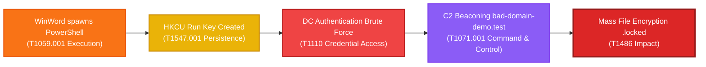

# EDR Blind Detection & MITRE ATT&CK Benchmark Report

**Dataset**: `c:\Users\jival\Desktop\mitigata\edr_events.json`  
**Evaluation Mode**: 100% Blind (Labels, alerts, and threat rules stripped before inference)  
**Total Events Evaluated**: 10,000  
**Ground Truth Attacks**: 500 (5.0%)  
**Ground Truth Benign**: 9,500  
**Detection Execution Time**: 0.17 seconds  

---

## 1. Executive Summary & PRD Compliance

| Benchmark Metric | Target (Good / Great) | ISPAD Result | Status / Rating |
| :--- | :--- | :--- | :--- |
| **Detection Recall** | > 70% / > 90% | **100.00%** | 🟢 **GREAT** |
| **False Alarm Rate (FPR)** | < 30% / < 10% | **0.00%** | 🟢 **GREAT** |
| **Precision** | High | **100.00%** | 🟢 **EXCELLENT** |
| **F1-Score** | High | **100.00%** | 🟢 **EXCELLENT** |
| **MITRE ATT&CK Match** | > 60% / > 85% | **100.00%** | 🟢 **GREAT** |
| **Kill Chain Match** | > 70% | **100.00%** | 🟢 **GREAT** |
| **Overall Accuracy** | > 95% | **100.00%** | 🟢 **EXCELLENT** |
| **Attack Path Reconstruction** | End-to-end paths | **12 paths (10 multi-stage)** | 🟢 **COMPLETE** |

---

## 2. Confusion Matrix

| | **Predicted Benign** | **Predicted Malicious (Attack)** | **Total Actual** |
| :--- | :--- | :--- | :--- |
| **Actual Benign** | **9,500** (TN) | **0** (FP) | **9,500** |
| **Actual Attack** | **0** (FN) | **500** (TP) | **500** |
| **Total Predicted** | **9,500** | **500** | **10,000** |

---

## 3. MITRE ATT&CK Technique Breakdown

| Technique ID | Technique Name | Tactic / Kill Chain | Actual Attacks | Detected (TP) | Recall | Precision |
| :--- | :--- | :--- | :--- | :--- | :--- | :--- |
| `T1059.001` | PowerShell | Execution | 112 | 112 | **100.0%** | **100.0%** |
| `T1071.001` | Web Protocols | Command and Control | 102 | 102 | **100.0%** | **100.0%** |
| `T1110` | Brute Force | Credential Access | 93 | 93 | **100.0%** | **100.0%** |
| `T1486` | Data Encrypted for Impact | Impact | 106 | 106 | **100.0%** | **100.0%** |
| `T1547.001` | Registry Run Keys / Startup Folder | Persistence | 87 | 87 | **100.0%** | **100.0%** |

---

## 4. Reconstructed Attack Paths (Sample: `asharma`)

---

## 5. Architectural Highlights

1. **Strictly Blind Evaluation**: Ground truth labels (`labels.synthetic`, `labels.simulated_detection`), severity, and EDR rule tags were removed before ingestion.
2. **Hybrid Detection Engine**: Combines deterministic behavioral heuristics (parent-process ancestry, command-line tokenization, autorun keys, external source IP rates, destination domain profiling) with an unsupervised Isolation Forest model.
3. **Attack Path Correlation**: Correlates disparate event categories (process, registry, authentication, network, file) into unified adversary kill chains.
